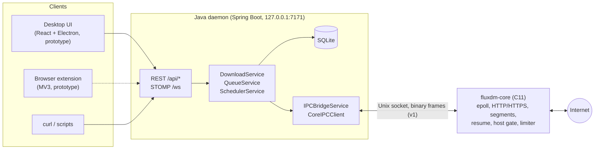

<h1 align="center">FluxDM</h1>

<p align="center">
  A multi-segment download manager for Linux: an epoll-driven C engine, a Java daemon that owns
  policy and persistence, and a small binary protocol between them.
</p>

<p align="center">
  <a href="https://github.com/PhillipWanjiru/Fluxdm/actions/workflows/ci.yml"></a>
  <a href="LICENSE"></a>
  
  
  
</p>

FluxDM is a from-scratch download manager for Linux in the tradition of IDM, XDM, aria2 and
JDownloader. The design goal is a fast transfer engine that stays out of the way of everything
else: the hot path (sockets, TLS, byte ranges, disk writes) lives in a small C core that runs
lock-free per download, while queueing, persistence, scheduling and the API live in a JVM daemon
that talks to the core over a versioned binary protocol on a Unix socket.

> **Status: early but real.** The C core and the daemon work end to end and are heavily tested.
> The browser extension, the video grabber and the desktop UI are prototypes that are not wired
> in yet. See [Project status](#project-status) and [docs/ROADMAP.md](docs/ROADMAP.md) for what is
> done and what is not.

## Highlights

- **Segmented transfers.** Up to 64 parallel HTTP/HTTPS connections per file. Segment boundaries
  are 4 KiB aligned, the output file is pre-allocated with `fallocate(2)`, and writes are coalesced
  into 256 KiB `pwrite()`s. Servers that ignore `Range` are handled as a single stream that reuses
  the probe's connection.
- **One thread per download, one epoll loop per download.** Every segment of a download is driven
  by the same worker thread, so segment code needs no locks. The IPC thread talks to workers only
  through atomics and an `eventfd`.
- **Crash-safe resume.** Per-segment progress is checkpointed every 3 s to `<file>.fluxpart`
  (written to a temporary file and renamed into place). A resume is refused if the remote file
  changed (`ETag` / `Last-Modified` and size are validated). Downloads survive `kill -9`.
- **Polite to servers.** A process-wide per-host gate learns how many connections a server
  tolerates from `HTTP 429` / `503`, honours `Retry-After`, and queues segments instead of
  hammering. It uses additive increase and multiplicative-ish decrease, the same shape TCP uses
  to find a link's capacity. See [docs/RATE_LIMITING.md](docs/RATE_LIMITING.md).
- **Bandwidth control.** Token-bucket limiters, per download and global, adjustable at runtime.
- **Integrity.** Streaming MD5 / SHA-256 verification when a checksum is supplied.
- **TLS 1.2 / 1.3** through OpenSSL with peer certificate and hostname / IP verification.
- **A daemon you can script.** REST API plus STOMP-over-WebSocket push, SQLite persistence, a
  bounded queue with priorities, a scheduler, and automatic recovery: downloads that were running
  when the daemon or the core stopped carry on from their checkpoint.
- **Tested like infrastructure.** C unit suites under AddressSanitizer + UBSan, a behaviour suite
  that drives the real core through scriptable mock servers (retries, resets, redirects, TLS, rate
  limits, crash recovery, IPC abuse), ThreadSanitizer builds, and Java suites that run the daemon
  against both a scripted fake core and the real binary. See [docs/TESTING.md](docs/TESTING.md).

## Architecture



The core and the daemon are separate processes. The daemon starts (or adopts) the core, keeps it
connected, restarts it if it dies, and re-synchronises its database with whatever the core is
running. Details are in [docs/ARCHITECTURE.md](docs/ARCHITECTURE.md); the wire format is
specified in [docs/IPC_PROTOCOL.md](docs/IPC_PROTOCOL.md).

## Project status

| Component | Directory | Language | Status |
|---|---|---|---|
| Download engine | [`core/`](core) | C11 | **Working.** Extensively tested (unit, integration, behaviour, sanitizers). |
| IPC protocol | [`ipc/`](ipc) | C headers | **Stable**, protocol version 1. |
| Daemon | [`daemon/`](daemon) | Java 21, Spring Boot 3.2 | **Working.** REST, STOMP, SQLite, queue, recovery. Tested with a harness; `mvn package` builds it. |
| Engine layer | [`engine/`](engine) | C++17 | **Library, not wired in.** Segment tuning, buffers and BitTorrent building blocks; built and unit-tested standalone. |
| Video grabber | [`grabber/`](grabber) | Python (FastAPI, yt-dlp) | **Prototype.** A thin yt-dlp wrapper with `/detect` and `/grab`; the daemon does not start it and its bridge is not aligned with it yet. |
| Browser extension | [`extension/`](extension) | JavaScript (Manifest V3) | **Skeleton.** Cancels a browser download and announces it, but nothing receives the announcement yet: the hand-off to the daemon is a stub. Do not load it for everyday browsing. |
| Desktop UI | [`ui/`](ui) | React, Redux, Electron | **Prototype.** Components and styles exist and the downloads list polls the REST API, but the app shell, the status mapping and the build entry point are unfinished. |

## Getting started

FluxDM targets Linux (it uses `epoll`, `eventfd` and `fallocate`). The commands below are for
Ubuntu / Debian.

### Prerequisites

```bash
sudo apt install build-essential libssl-dev python3 openjdk-21-jdk maven
```

The C++ engine tests additionally need `g++` (part of `build-essential`).

### Build and run

```bash
git clone https://github.com/PhillipWanjiru/Fluxdm.git
cd Fluxdm
bash dev_start.sh          # builds core/fluxdm-core, builds the daemon, starts it on 127.0.0.1:7171
```

The first run downloads the daemon's Maven dependencies, which can take a few minutes.

By default the daemon looks for the core at `~/Desktop/fluxdm/core/fluxdm-core`. If you cloned
somewhere else, point it at your build:

```bash
java -jar daemon/target/fluxdm-daemon.jar --fluxdm.core.binary-path="$PWD/core/fluxdm-core"
```

### Use it

```bash
# add a download (8 segments by default; filePath must be absolute or start with ~/)
curl -s -X POST http://127.0.0.1:7171/api/downloads \
     -H 'Content-Type: application/json' \
     -d '{"url":"https://example.org/big-file.iso","filePath":"~/Downloads/big-file.iso","segments":8}'

curl -s http://127.0.0.1:7171/api/downloads            # list
curl -s -X POST http://127.0.0.1:7171/api/downloads/1/pause
curl -s -X POST http://127.0.0.1:7171/api/downloads/1/resume
curl -s -X PUT  http://127.0.0.1:7171/api/downloads/1/limit \
     -H 'Content-Type: application/json' -d '{"bytesPerSec":500000}'   # 0 = unlimited
curl -s -X DELETE http://127.0.0.1:7171/api/downloads/1                # cancel
curl -s http://127.0.0.1:7171/api/health                               # daemon + core status
```

| Method and path | Purpose |
|---|---|
| `GET /api/downloads`, `GET /api/downloads/{id}` | List, inspect |
| `POST /api/downloads` | Start a download (`url`, `filePath`, optional `segments`, `priority`, `bandwidthLimit`, `checksumType` + `checksum`) |
| `POST /api/downloads/{id}/pause`, `/resume` | Pause, resume |
| `PUT /api/downloads/{id}/limit` | Per-download speed limit in bytes/s |
| `DELETE /api/downloads/{id}` | Cancel and remove partial files |
| `GET /api/bandwidth`, `PUT /api/bandwidth` | Daemon-wide speed limit (`globalLimitBps`) |
| `GET /api/stats`, `GET /api/health` | Totals and live speed; liveness of daemon and core |
| `GET/POST/DELETE /api/scheduler` | Scheduled resumes (one-shot or repeating) |
| `ws://127.0.0.1:7171/ws` (STOMP) | Live progress on `/topic/downloads` and `/topic/downloads/{id}` |

Errors come back as `{"error": "..."}` with a fitting status (400, 404, 409, 503).

### Run the core on its own

```bash
make -C core
core/fluxdm-core --help
core/fluxdm-core --limit 0 --log 1 --patience 300
```

| Option | Meaning |
|---|---|
| `--sock <path>` | Unix socket to listen on (mode `0600`). Default: `$XDG_RUNTIME_DIR/fluxdm/core.sock`, else `~/.fluxdm/run/core.sock`; the directory is created private |
| `--limit <bytes/s>` | Global bandwidth cap, `0` = unlimited |
| `--log <0\|1\|2>` | Quiet, info, debug |
| `--patience <s>` | How long a download keeps waiting for a server that answers `429`/`503` while it serves none of our connections (default 300) |

### Daemon configuration

Defaults live in [`daemon/src/main/resources/application.properties`](daemon/src/main/resources/application.properties).
Any of them can be overridden on the command line (`--key=value`).

| Property | Default | Meaning |
|---|---|---|
| `server.address`, `server.port` | `127.0.0.1`, `7171` | Where the API listens. Keep it on loopback: the API has no authentication. |
| `spring.datasource.url` | `jdbc:sqlite:${user.home}/.fluxdm/fluxdm.db` | Database file (the daemon creates `~/.fluxdm/` on first start) |
| `fluxdm.core.binary-path` | `${user.home}/Desktop/fluxdm/core/fluxdm-core` | Core binary the daemon spawns |
| `fluxdm.core.socket-path` | *(unset)* | IPC socket. Unset, it is `$XDG_RUNTIME_DIR/fluxdm/core.sock`, or `~/.fluxdm/run/core.sock` when that directory is not private; the directory is created mode `0700`. Set it only to put the socket somewhere else. |
| `fluxdm.core.global-limit-bps` | `0` | Global speed cap |
| `fluxdm.core.patience-seconds` | `300` | Rate-limit patience passed to the core |
| `fluxdm.max-concurrent-downloads` | `4` | Downloads running at once; the rest wait in the queue |
| `fluxdm.recovery.auto-resume` | `true` | Restart interrupted downloads when the core reconnects |

## Testing

```bash
bash tests/run_all.sh            # C unit + integration + behaviour suites (several minutes; --quick for less)
bash tests/run_daemon_tests.sh   # Java suites against a fake core and the real core (--no-maven to skip the Maven step)
bash tests/run_engine_tests.sh   # C++ engine layer
```

Details, what each suite proves and how to run the sanitizer builds are in
[docs/TESTING.md](docs/TESTING.md).

## Repository layout

```
core/        C11 download engine: epoll loop, segments, HTTP/HTTPS, resume, host gate, limiter, IPC server
ipc/         Wire-protocol headers shared by the core and the daemon (protocol v1)
daemon/      Spring Boot daemon: REST, STOMP, SQLite, queue, scheduler, core supervisor
engine/      C++17 engine layer (segment tuning, buffers, BitTorrent building blocks)
grabber/     Python video-grabber service (FastAPI + yt-dlp), prototype
extension/   Browser extension (Manifest V3), prototype
ui/          React + Electron desktop UI, prototype
db/          Reference SQL schema, migrations and seed data
config/      Example runtime configuration files
tests/       Unit, integration, behaviour, daemon and engine test suites and their harnesses
docs/        Architecture, protocol, rate limiting, testing, roadmap
.github/     CI and release workflows, issue forms, pull-request template, helper scripts
.githooks/   Local git hooks: commit-message format, no secrets or huge files (see CONTRIBUTING.md)
```

> **History.** `main` starts from the cleaned-up 0.1.0 tree. The working-folder backups that came
> before it are kept, oldest first, as one snapshot commit each on the
> [`archive/desktop-backups`](https://github.com/PhillipWanjiru/Fluxdm/tree/archive/desktop-backups)
> branch. They are not part of `main`'s history.

## Roadmap

Next up, in rough order: a "waiting for server" state in the daemon and UI, wiring the UI to the
daemon, the browser-extension hand-off, the grabber service, then engine-layer integration
(dynamic segment rebalancing, TLS session reuse). The full list, including known limitations, is
in [docs/ROADMAP.md](docs/ROADMAP.md).

## Contributing

Issues and pull requests are welcome. Read [CONTRIBUTING.md](CONTRIBUTING.md) first: it covers
the commit-message convention (Conventional Commits), the test expectations and the local git hooks.
Security problems: see [SECURITY.md](SECURITY.md). Everyone taking part is expected to follow the
[code of conduct](CODE_OF_CONDUCT.md).

## License

[MIT](LICENSE)
