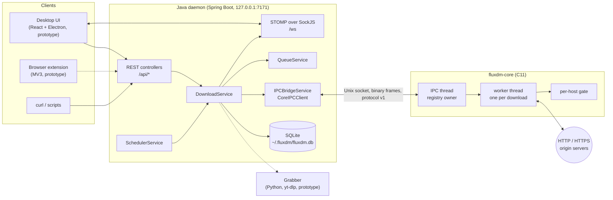
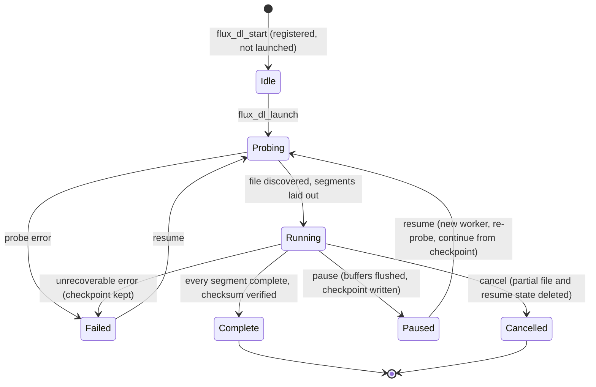
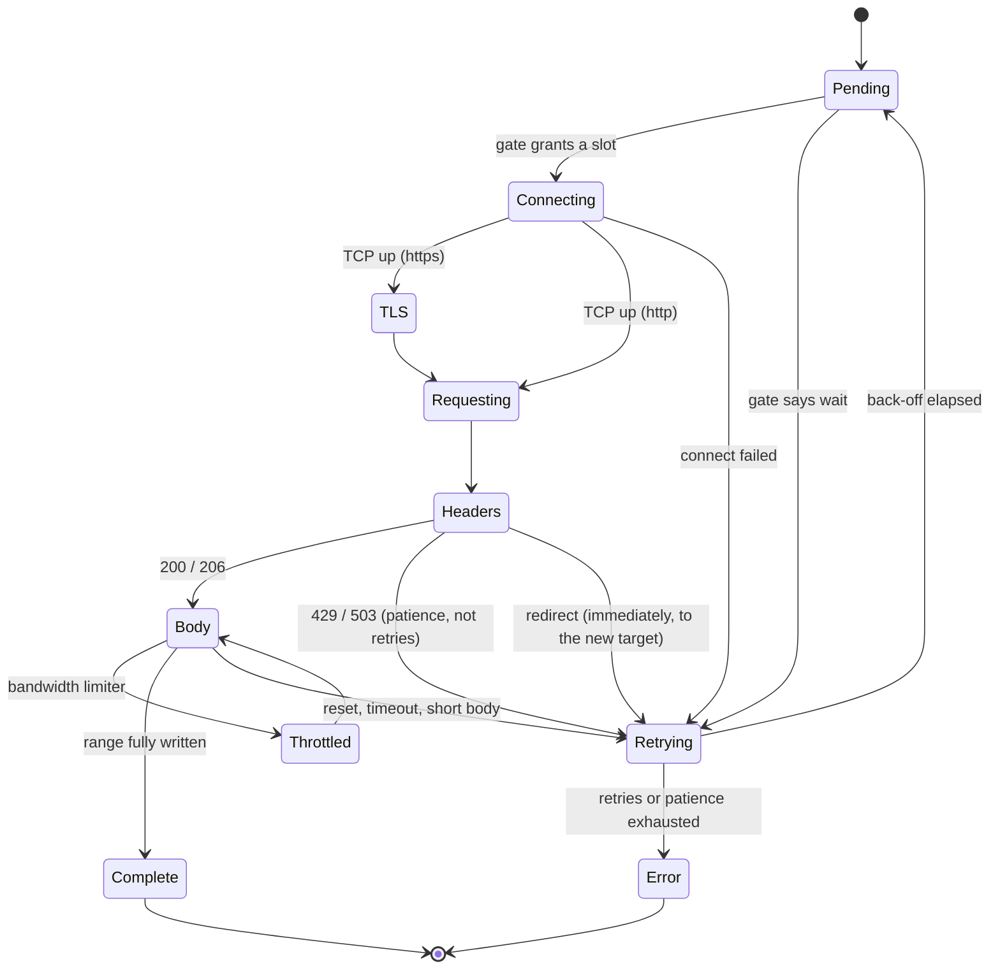
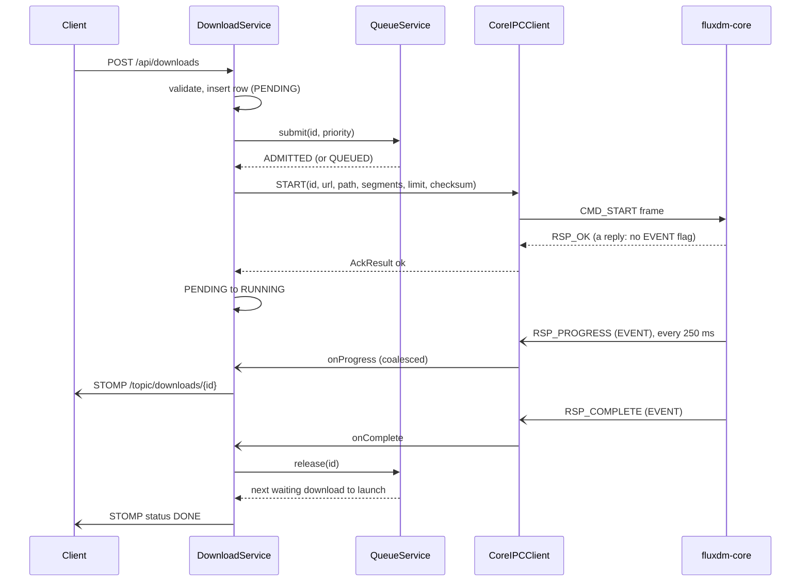

# Architecture

How FluxDM is put together, and why. Numbers in this document name the constant that defines them,
so they can be checked against the source (`core/include/*.h`, `core/src/*.c`).

- [1. System context](#1-system-context)
- [2. The C core](#2-the-c-core)
- [3. The Java daemon](#3-the-java-daemon)
- [4. Failure handling](#4-failure-handling)
- [5. Design decisions](#5-design-decisions)
- [6. Security model](#6-security-model)

## 1. System context



| Component | Owns | Does not own |
|---|---|---|
| **Core** (`core/`) | Sockets, TLS, HTTP framing, byte ranges, segment scheduling, disk writes, resume files, bandwidth limiting, per-host connection policy | Persistence, queueing, scheduling, anything user-facing |
| **Daemon** (`daemon/`) | The REST / STOMP API, the database, the concurrency queue, scheduled resumes, supervising the core, recovery after restarts | The transfer itself |
| **IPC protocol** (`ipc/`) | The contract between the two (see [IPC_PROTOCOL.md](IPC_PROTOCOL.md)) | |
| **Engine layer** (`engine/`) | C++17 building blocks: adaptive tuner, buffer manager, segment manager, bencode / metadata parser, peer discovery | Not linked into the core yet; built and unit-tested standalone |
| **Grabber, extension, UI** | Prototypes of the video-grabber service, the browser hand-off and the desktop UI | Not wired in yet |

The split is deliberate. The transfer path is where latency, memory and system-call overhead matter, so
it is C with no runtime between it and the kernel. Everything that benefits from a mature ecosystem
(HTTP API, persistence, WebSocket push, scheduling) is Java. The two meet at one narrow, versioned,
tested seam.

## 2. The C core

### 2.1 Threads

| Thread | Count | Responsibility |
|---|---|---|
| **IPC thread** | 1 | Runs the `epoll` loop over the listening socket, up to 16 client connections (`FLUX_IPC_MAX_CLIENTS`) and a wake-up `eventfd`. Reads commands, owns the download registry, replies to commands. |
| **Worker** | 1 per download | Probes, prepares, then drives all segments of its download from one `epoll` loop. Pushes events (progress, completion, asynchronous errors) into the client output queues. |

The rules that follow from this:

- **Segment code takes no locks.** All segments of a download are driven by that download's one
  worker thread. Cross-thread state (`state`, `downloaded_bytes`, `total_size`, pause and stop
  requests) is touched only through acquire / release atomics.
- **The IPC thread is the sole owner of the registry.** It joins and frees finished downloads
  (`flux_registry_reap`, once a second, after `FLUX_DL_RETAIN_MS` = 10 min so a client can still ask
  about a download that just finished), so a worker never frees itself and an id lookup is always safe
  to dereference. The registry is a 1024-bucket hash table (`FLUX_REG_BUCKETS`).
- **The only state shared between downloads** is the per-host gate ([RATE_LIMITING.md](RATE_LIMITING.md))
  and the global token bucket, each behind one mutex that is held for a few instructions at a time.
- **Workers never block on a slow client.** Every frame goes through a per-client output queue and
  is appended whole under that client's lock, so frames from different threads cannot interleave.
  Above `FLUX_IPC_OUT_SOFT` (256 KiB) progress frames are dropped, because the next one supersedes
  them. Above `FLUX_IPC_OUT_HARD` (8 MiB) the client is disconnected.

### 2.2 The life of a download



A `START` is acknowledged before the worker is launched, so a client always sees the `OK` first and
the events after. A pause that has not yet taken effect can be withdrawn by an immediate resume.

**Probe.** One ranged `GET` with `Range: bytes=0-0` discovers the size, whether ranges are supported,
the validators (`ETag`, `Last-Modified`), the final URL after up to `HTTP_MAX_REDIRECTS` = 10
redirects, and the peer address. It is a ranged GET and not a `HEAD` because some servers drop or
mishandle `HEAD`. It runs on `poll()` loops that also watch the worker's wake-up `eventfd`, so a pause
or cancel interrupts it immediately; DNS resolution is the one blocking call. Transient failures get
`PROBE_ATTEMPTS` = 4 tries. A server that answers `429` / `503` is waited for as long as the patience
allows rather than failed (see [RATE_LIMITING.md](RATE_LIMITING.md)). When the server ignores `Range`
and answers `200`, the probe's connection is adopted by a single segment, so the body that was
already in flight is not thrown away.

**Prepare.** Decide whether the partial file on disk can be resumed (2.5), open the output, reserve
its full size with `fallocate(2)` (so a full disk fails at the start, and the file stays contiguous),
and lay out the segments (2.3).

**Run.** Drive the segments from one `epoll` loop. Every `FLUX_PROGRESS_INTERVAL_MS` = 250 ms emit a
progress event and take a speed sample. Every `FLUX_RESUME_SAVE_MS` = 3 s write a checkpoint.

**Finish.** Exactly one of: *complete* (flush, verify the checksum if one was supplied, delete the
resume state, emit `COMPLETE`), *pause* (flush, checkpoint), *stop* (cancel: delete the partial file
and resume state), or *fail* (flush, checkpoint, emit `ERROR`). A finished download's output file is
never touched afterwards, not even by a later cancel.

### 2.3 Segments

A download of `total` bytes is split into `n` segments, each owning one byte range and one
connection:

```
n = min(requested, 64, total / 256 KiB)        requested defaults to 8
n = 1                                          if the server has no range support or the size is unknown
chunk = total / n, rounded down to a multiple of 4 KiB (when n > 1)
segment i covers [i * chunk, (i + 1) * chunk - 1]; the last one runs to the end
```

The `256 KiB` floor (`FLUX_MIN_SEGMENT_BYTES`) stops a small file from being shredded into pointless
connections, and the `4 KiB` alignment (`ALIGN_SEG`) keeps every segment's writes on page boundaries.

Every segment obeys one accounting rule, and everything else hangs off it:

```
received = written + wbuf_len
```

`written` bytes are in the file; `wbuf_len` bytes are in the write buffer, waiting for the next
`pwrite()`. The next byte a segment expects belongs at file offset `range_start + received`, and a
re-request after a failure always starts there. Using `written` alone would download the buffered
bytes twice and count them twice.



**Disk I/O.** Segments read from their socket into a buffer and flush it with `pwrite()` at the
segment's own offset whenever it reaches `FLUX_WRITE_BUF_CAP` (256 KiB), when the body ends, and at
least once per `SEG_FLUSH_IDLE_MS` (1 s) even when it is not full. No segment ever seeks, so all of
them can share one file descriptor. Each pump call reads at most `SEG_PUMP_BUDGET` (1 MiB) and then
yields, so one fast connection cannot starve its siblings. A connection that delivers nothing for
`FLUX_CONN_RECV_TOMS` (30 s) counts as failed; connecting is allowed `FLUX_CONN_CONNECT_TOMS` (10 s).

**Failure handling.** An ordinary failure (reset, timeout, truncated body, a retryable `5xx`) retries
with exponential back-off from `SEG_BACKOFF_BASE_MS` (500 ms) up to `SEG_BACKOFF_MAX_MS` (15 s) with
jitter derived from the segment index, so siblings do not come back in lockstep, and a longer
`Retry-After` wins over the computed delay. A segment gives up after `SEG_MAX_RETRIES` (8) failures
*without progress*: receiving `SEG_RETRY_RESET_BYTES` (16 KiB) forgives the earlier failures.
Certificate errors and responses that cannot be right (a non-retryable `4xx`, the wrong byte range,
a size that differs from the probe's) are fatal at once. A `429` / `503` is not a fault of the
connection and does not spend a retry; the host gate handles it with its own time budget. A redirect
seen by one segment moves the whole download to the new target, and its siblings retry against it
straight away. The first segment to fail for good fails the download: the other segments are halted,
their buffers flushed and the checkpoint written, so the download ends in `ERROR` with its progress
kept and can be resumed.

### 2.4 HTTP and TLS

- HTTP/1.1 with `Content-Length`, chunked transfer-encoding (decoded by a small state machine in the
  segment), `Accept-Encoding: identity` so byte offsets mean what they say, redirects (301, 302, 303,
  307, 308), and Basic authentication from URL userinfo. Response heads are capped at
  `HTTP_MAX_HEADER_LEN` (16 KiB).
- HTTPS through OpenSSL: TLS 1.2 minimum, `SSL_VERIFY_PEER` against the system trust store, and
  hostname verification (`SSL_set1_host`) or IP verification for literal addresses. There is no
  option to switch verification off.
- A response that does not match the request is refused rather than written into the file: a `206`
  whose `Content-Range` starts elsewhere, a plain `200` to a ranged request, or a total size that
  differs from the probe's all end the segment with a `RANGE` error.
- Log lines never contain URL credentials or query strings: signed URLs carry their secrets there.

### 2.5 Resume

Per-download state lives next to the output file in `<file>.fluxpart`:

| Offset | Content |
|---|---|
| 0 | 128-byte header: magic `FLXP`, version, download id, segment count, total size, checksum type and value, **validator**, padding |
| 128 | one 32-byte entry per segment: `range_start`, `range_end`, `written`, status |
| after | `u16 url_len` + URL, `u16 path_len` + path |

- **Atomic.** Saved to `<file>.fluxpart.tmp`, then `rename(2)`d over the old file, so a crash
  leaves either the previous checkpoint or the new one, never a torn file.
- **Validator.** An FNV-1a hash of `Last-Modified` (else a strong `ETag`), mixed with the file size.
  A resume is refused when it no longer matches: the remote file changed and the bytes on disk would
  be a splice of two versions.
- **What is checked before reuse.** The server supports ranges; the size matches; the validator
  matches; the URL matches (or differs only in its query *and* the validators vouch for it, which
  covers refreshed signed URLs); the segment table is contiguous, covers `[0, total)` exactly, and no
  segment claims more than its range; the partial file exists, is a regular file, and has the right
  size. Anything else starts the download over, and the log says why.
- **Cost of a crash.** At most `FLUX_RESUME_SAVE_MS` (3 s) of progress per segment is repeated. Because
  the file is pre-allocated and every write is positional, repeating a range overwrites the same
  bytes and is harmless.

### 2.6 Bandwidth limiting

A token bucket per download and one global bucket, adjustable at runtime (`CMD_SET_LIMIT`; id 0 is the
global limit). Segments **charge** bytes that have already been received instead of asking permission
first (`flux_bw_charge`): by the time a read returns, the bytes are in our buffer, so the honest
accounting is to record them and delay the *next* read. A shortfall becomes debt that later refills
repay, and the long-run rate converges on the configured one. Downloads use a 250 ms bucket depth
(`DL_BW_BURST_MS`), so a small file under a limit is held to the limit from its first byte instead of
arriving in one burst. A throttled segment parks in `Throttled` and costs nothing until its timer
fires.

### 2.7 Errors

Every failure sets a thread-local error (`flux_set_error`) with a code and a formatted message, and
the core maps its internal codes to the stable wire codes in the protocol (invalid URL, network,
timeout, disk, TLS, not found, forbidden, server, range, checksum, internal). Messages are cut at
UTF-8 character boundaries when they exceed the fixed 124-byte field.

## 3. The Java daemon

### 3.1 Services

| Class | Role |
|---|---|
| `DownloadService` | The download logic: REST requests in, commands to the core out, core events back into the database and out over STOMP. |
| `QueueService` | Bounded concurrency (`fluxdm.max-concurrent-downloads`). Pure bookkeeping: it never starts anything and holds no lock while the caller talks to the core. |
| `CoreIPCClient` | The persistent Unix-socket client: frame codec, reply matching, event dispatch. |
| `IPCBridgeService` | Finds, adopts or spawns the core, supervises it, shuts it down. |
| `SchedulerService` | Resumes a download at a `triggerAt` time, optionally repeating. |
| `BandwidthService` | The daemon-wide speed limit. |
| `GrabberService`, `PythonBridge` | Hand-off to the video-grabber service (prototype). |

### 3.2 Starting a download



### 3.3 Rules that keep the pieces in step

1. **One state lock, never held across IPC.** `DownloadService` guards every database
   read-modify-write together with the slot bookkeeping it belongs to, and releases the lock before
   it talks to the core. Command results are applied under the lock again, re-checking the state they
   find: whatever the user did in the meantime wins.
2. **Slots are tracked by download id, not by counting.** Release is idempotent, so two signals for the
   same end (an error event racing a cancel) free one slot, not two, and the active count cannot drift
   below the truth and admit more downloads than allowed. Order in the line: higher `priority` (1..10)
   first, then first come first served.
3. **Status changes are guarded transitions.** `PENDING` to `RUNNING` only from `PENDING`; `ERROR`
   only from `PENDING` / `RUNNING`; and so on. A late event for a download the user already paused or
   cancelled cannot undo that.
4. **Pause, resume and cancel wait for the core's answer** (bounded), so the HTTP response tells the
   truth. A command on a download whose `START` is still in flight waits for that to settle first, so
   commands reach the core in the order the user gave them.
5. **Reply matching is positional.** The core answers commands in the order it read them, on one
   thread per connection, so the client keeps one FIFO of pending commands and each reply completes
   the head. Nothing is keyed by download id, so two commands for the same download in flight at once
   cannot steal each other's answers. The `EVENT` flag is the only thing that tells "the answer to my
   PAUSE 7" from "download 7 just failed", since both are `RSP_ERROR` frames with id 7. A reply that
   does not fit the head of the FIFO means the sides lost step; the client drops the connection and
   resynchronises.
6. **Nothing heavy on the reader thread.** The socket reader only parses frames. Futures and listener
   callbacks run on one dispatcher thread, in the order the core produced them, and progress events are
   coalesced per download while they wait, so a slow database write can delay callbacks but can never
   stall the socket (the core disconnects clients that stop reading).
7. **Commands never throw.** Each returns a future that always completes with an `AckResult`: a
   positive wire code from the core, or a negative `ERR_*` code for problems on this side (not
   connected, connection lost, no reply in time).
8. **Reconcile after every (re)connection.** The daemon asks the core what it is running
   (`STATUS_ALL`) and compares that with the database: downloads that were running when the daemon or
   the core went down are started again and carry on from their checkpoint; downloads the core
   finished or lost in the meantime are corrected. Until that has happened, operations that need the
   core answer `503` rather than guess.

### 3.4 Persistence

SQLite through JPA (`ddl-auto=update`), with the Hikari pool limited to one connection because SQLite
allows a single writer and one pooled connection serialises access instead of failing with
"database is locked". `db/schema.sql` is the reference copy of the schema; the live one is generated
from the entities. Download status values: `0` pending, `1` running, `2` paused, `3` done, `4` error.
Per-segment progress is deliberately not persisted: the core tracks it, and aggregate progress is all
the protocol reports today.

### 3.5 Core supervision

`IPCBridgeService` adopts a core that is already serving the socket (the daemon restarted while the
core kept running) and otherwise spawns one with `--sock`, so the two can never disagree about the
path. A supervisor thread checks the connection every second; if the core died it restarts the core
(when it is ours) with a back-off from 500 ms to 15 s, and a connection that stays up for 10 s forgives
the last crash. On shutdown only a core the daemon spawned is stopped (`SHUTDOWN`, then `SIGTERM`,
then `SIGKILL` as a last resort); an adopted core is left running. The socket file is never deleted
by the daemon: the core refuses a socket that a live process serves and replaces a stale one itself.

## 4. Failure handling

| Event | What happens |
|---|---|
| Core crashes or is `kill -9`'d | The supervisor notices within a second and restarts it with back-off. After reconnecting, the daemon reconciles: interrupted downloads restart and continue from their last checkpoint (or come back paused with `fluxdm.recovery.auto-resume=false`). |
| Daemon restarts | A running core is adopted and downloads continue without interruption. |
| Power loss mid-download | Up to 3 s of per-segment progress is repeated on the next run; the file is not corrupted, because all writes are positional into a pre-allocated file. |
| Remote file changes while paused | The validator no longer matches: the download starts over and the log says why. |
| Disk too small | `fallocate` fails at the start with a disk-space error, before any bytes are fetched. |
| Server answers `429` / `503` | Handled by the host gate: connections are cut to what the server tolerates, `Retry-After` is honoured, and the download waits within its patience ([RATE_LIMITING.md](RATE_LIMITING.md)). |
| Server ignores `Range` | One segment adopts the probe's connection and streams the whole body. |
| A client stops reading events | Progress frames are dropped above 256 KiB queued; the client is disconnected above 8 MiB. Other clients and all downloads are unaffected. |
| Malformed IPC frame (bad magic, bad version, oversized payload) | The client is disconnected; the stream cannot be resynchronised. The core keeps running. |
| 17th client connects | Refused (`FLUX_IPC_MAX_CLIENTS` = 16). |
| Checksum mismatch | The download ends in `ERROR` with the checksum wire code. The file is deleted, because a file that failed verification must not sit at its final name looking finished, and its resume state is discarded. |

## 5. Design decisions

**Two processes instead of JNI.** A crash, leak or stall in the transfer engine must not take down the
API, and the reverse. A socket boundary makes each side independently restartable, and the daemon
proves it can recover: the supervisor, the adoption logic and the reconcile step exist because the
boundary is real.

**One thread and one `epoll` loop per download.** Parallelism across downloads comes from threads;
parallelism inside a download comes from non-blocking sockets. That keeps segment code free of locks
(the hardest class of bug to test for), makes cancellation a matter of one flag and one `eventfd`,
and bounds a download's footprint (a 512 KiB worker stack plus one 256 KiB write buffer per
segment).

**Ranged `GET` as the probe.** It answers the three questions that matter (size, range support,
validators) in one round trip, works against servers that mishandle `HEAD`, and, when ranges turn out
to be unsupported, its connection is simply the download.

**Byte accounting by `received`, not `written`.** Re-requesting from `range_start + received` means a
failure never re-downloads or double-counts buffered bytes. The behaviour suite checks the SHA-256 of
every file it downloads, including across resets, retries and resumes, and that progress never goes
backwards or past the total.

**Charge-after-read rate limiting.** Refusing a charge for bytes already in the buffer would lose track
of data that really crossed the network. Debt-based accounting is exact on average and needs no timers
on the fast path.

**A shared, learning host gate instead of per-download politeness.** Rate limits are a property of the
*server*, not of one download. Two downloads from the same host must share what the host tolerates, so
the policy is process-wide ([RATE_LIMITING.md](RATE_LIMITING.md)).

**A versioned, fixed-layout binary protocol.** 16-byte header, little-endian, packed structs whose
sizes are pinned by `_Static_assert` in the core, so an accidental layout change breaks the build
instead of production. The Java codec mirrors the layout and is exercised against both a scripted
fake core and the real binary.

**Positional acknowledgement instead of request ids.** The core handles commands on one thread in
arrival order, so replies are ordered per connection and no id bookkeeping is needed. The `EVENT` flag
removes the one ambiguity that remains.

## 6. Security model

- **The API listens on `127.0.0.1` only, and every request proves where it comes from.** It starts
  downloads that write anywhere the daemon's user can write, so `security/ApiGuardFilter` runs in front
  of Spring MVC and `security/ApiGuard` decides, in this order: `Host` must be one of
  `fluxdm.api.allowed-hosts` (a page that DNS rebinding has pointed at `127.0.0.1` still names its own
  host, so this stops rebinding); `Origin`, when present, must be one of `fluxdm.api.allowed-origins`
  (exact strings; `null` and wildcards are refused), which stops cross-site requests and WebSocket
  hijacking; and the request must carry `Authorization: Bearer <token>`. The token is 256 random bits in
  `~/.fluxdm/api-token` (mode `0600`, created atomically on first start, kept across restarts, compared
  in constant time); the daemon refuses to start if it cannot prepare the file. A CORS preflight and the
  `/ws` handshake carry no token, because browsers cannot add headers there, so only their `Host` and
  `Origin` are checked (the `/ws` exemption matches the URI exactly as sent, in plain form only, so
  `/ws/../api/downloads` is not exempt; for the same reason nothing but the SockJS endpoint may ever be
  served under `/ws`); on the WebSocket, `security/StompAuthInterceptor` requires the token in the
  `CONNECT` frame and refuses every other frame until a `CONNECT` has succeeded. Refusals are fixed
  texts that never echo client input and are logged at most once every 30 seconds per kind. The token
  protects against web pages and other accounts, not against other programs running as the same user
  ([SECURITY.md](../SECURITY.md#known-limitations)).
- **The IPC socket is mode `0600` and lives in a directory only its user can enter**:
  `$XDG_RUNTIME_DIR/fluxdm/` when that is a private directory of the user's, otherwise
  `~/.fluxdm/run/`. Both the core (`core/src/ipc/sock_path.c`) and the daemon (`security/RuntimeDir`)
  create the directory mode `0700`, close one that was left open, and refuse a symbolic link, a file
  or another user's directory, so nobody else can plant a socket there for the daemon to adopt. The
  core will not take over a socket that a live process serves, and it never deletes a path that is not
  a socket. `~/.fluxdm` itself, which also holds the database and the token, is mode `0700` too
  (`security/DataDir`).
- **TLS verification cannot be disabled.** Peer certificate and hostname (or IP) checks are always on.
- **Untrusted input is validated at every boundary**: URL, path and payload lengths and embedded NULs
  in `CMD_START`; frame magic, version and size; the `.fluxpart` file's structure before any of it is
  used; chunked-encoding and header sizes in the HTTP parser.
- **Secrets stay out of logs**: credentials in URL userinfo and signed query strings are stripped.

Report vulnerabilities as described in [SECURITY.md](../SECURITY.md).
